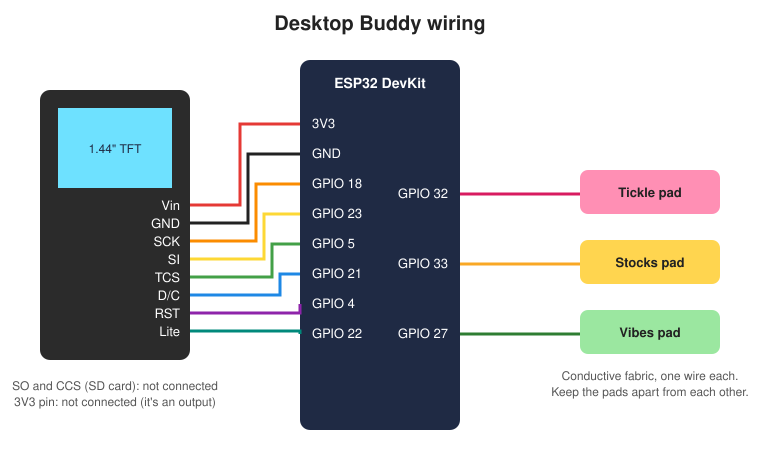

# Desktop Buddy

A desk friend built from an ESP32, a 1.44" 128x128 TFT and three conductive fabric touch buttons. A pixel-art kitten lives in a little room on the screen. She wanders about, plays with her yarn, naps, climbs the walls and reacts when you touch her. The other two buttons show live stock prices and positive quotes. The room's window shows the real weather outside.

Built with PlatformIO, [Adafruit GFX](https://github.com/adafruit/Adafruit-GFX-Library), [Adafruit ST7735](https://github.com/adafruit/Adafruit-ST7735-Library) and [ArduinoJson](https://arduinojson.org/).

## What it does

**The kitten** walks around, sits and blinks, bats her yarn ball across the floor, stretches, washes her paw, chases her tail, climbs the walls and takes little cat naps. If nobody plays with her for a while she gets restless and paces about asking to be petted. Late at night she curls up asleep and the screen dims.

**The window** shows the real weather from [Open-Meteo](https://open-meteo.com/) (free, no account needed): sun or moon, clouds, rain, snow, fog or a thunderstorm, plus the temperature. It follows real sunrise and sunset.

**Birthday mode:** on the date set in `config.h`, she wears a party hat, confetti falls all day and she wishes a happy birthday.

## The three buttons

| Button | GPIO | Touch | Hold |
|--------|------|-------|------|
| Tickle | 32 | She pounces on the yarn and hearts float up. Every tickle unwinds a strand of yarn across the room. Tickle fast enough and the screen floods pink... then it's all tidied up. Five quick tickles = zoomies! | |
| Stocks | 33 | First touch shows all your stocks. Each touch after that shows the next one in detail | Phone setup screen |
| Vibes | 27 | A random positive quote | |

**Stocks:** green ▲ is up since yesterday's close, red ▼ is down. A stock flashes when it moves 3% or more in a day, or when it reaches a buy-below or sell-above price you set. Prices come from Yahoo Finance and update every 2 minutes.

**Secret:** three quick tickles, then touch and *hold* the fourth. The message is `SECRET_MESSAGE` in `config.h`.

## Setting up WiFi

Buddy works offline (the kitten and quotes), but needs WiFi for stocks, weather and the clock.

1. Hold the **Stocks** button until the phone screen appears, then tap **Tickle**.
2. Scan the QR code on the screen with your phone camera, or join the **DesktopBuddy** WiFi network.
3. The setup page usually pops up by itself. If not, open `http://192.168.4.1`.
4. Pick your WiFi, type the password and tap **Connect**. Buddy remembers it from then on.

The ESP32 only works with 2.4GHz WiFi. If your router shows two network names, pick the one that isn't 5G.

## Picking stocks from your phone

With your phone on the same WiFi as Buddy, open **http://buddy.local** (or the address shown when you hold the Stocks button). You can choose up to 8 tickers, such as `AAPL`, `BTC-USD` or `^GSPC`, and set a buy-below or sell-above price for each one. It starts with AAPL, MSFT, NVDA, GOOGL, AMZN, META, TSLA and AVGO.

## Settings

Everything you might want to change is in `src/config.h`:

- **Pins** for the display and touch buttons
- **`TIMEZONE`**: set to Atlantic time; other time zones are listed beside it
- **`WEATHER_LAT` / `WEATHER_LON`**: where the weather comes from (set to Halifax, Nova Scotia)
- **`BIRTHDAY_MONTH` / `BIRTHDAY_DAY`**: party day (`0` turns it off)
- **`SECRET_MESSAGE`**: the Easter egg message
- **`SLEEP_HOUR` / `WAKE_HOUR`**: bedtime
- **`TOUCH_PERCENT`**: touch sensitivity

The quotes are in `src/quotes.h`. Add your own, and keep them short so they fit the screen.

## Touch buttons

Each button calibrates itself at power-on, so keep your hands off for a moment. On the classic ESP32 a touch makes the reading *drop*. If a button doesn't respond or triggers by itself, open the serial monitor at 115200 and type:

| Key | Does |
|-----|------|
| `t` | Shows the live reading for each button. `*` means it's being touched |
| `c` | Re-calibrates the buttons (hands off!) |

If two buttons always show exactly the same number, their wires or fabric are touching each other.

## Customising the kitten

The kitten is drawn in `src/cat.cpp` from little pictures made of letters. Each letter is one pixel: `K` outline, `O` ginger fur, `o` stripes, `W` white, `P` pink, `E` eye, and `.` for see-through. Keep every row 16 characters wide. Change the colours in `colourOf()`.

## Need help with the wiring?

| Display pin | ESP32 |
|-------------|-------|
| Vin | 3V3 |
| GND | GND |
| SCK | 18 |
| SI | 23 |
| TCS | 5 |
| D/C | 21 |
| RST | 4 |
| Lite | 22 |
| SO, CCS | not connected (SD card, not used) |

Use the display's **Vin** pin for power (it takes 3-5V). Its **3V3** pin is an output: leave it unconnected.

## Questions?

Ask on the [discussion board](https://github.com/cmoz/YouTube/discussions).
